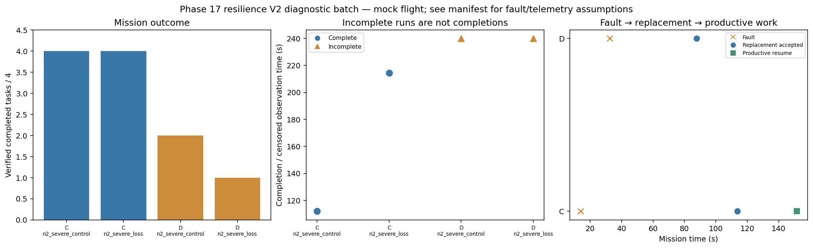

# Phase 17 resilience V2 diagnostic batch

Stage: severe; 4/4 runs; 2 completed missions.
Stored size: 2.94 MiB. Fault trigger: owned_motion. Telemetry: alive.

This is a new declared scenario, not final calibration. Replay is not LLM inference. Successful state-triggered recovery does not validate full radio-loss recovery.

| Case | Completed tasks | Complete | Time (s) | Replacement accepted at (s) | Productive resume at (s) |
|---|---:|---|---:|---:|---:|
| C_n2_severe_control_s8 | 4 | True | 112.00008126406465 | None | None |
| C_n2_severe_loss_s8 | 4 | True | 214.40009563602507 | 113.60008795501199 | 151.60010105499532 |
| D_n2_severe_control_s8 | 2 | False | 239.80010106193367 | None | None |
| D_n2_severe_loss_s8 | 1 | False | 239.80050336499698 | 87.80008922307752 | None |

