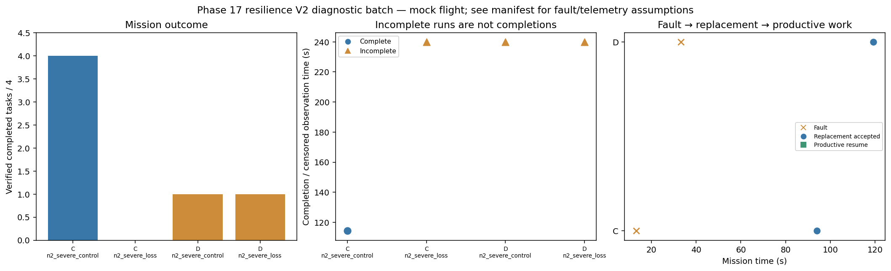

# Phase 17 resilience V2 diagnostic batch

Stage: severe; 4/4 runs; 1 completed missions.
Stored size: 2.89 MiB. Fault trigger: owned_motion. Telemetry: alive.

This is a new declared scenario, not final calibration. Replay is not LLM inference. Successful state-triggered recovery does not validate full radio-loss recovery.

| Case | Completed tasks | Complete | Time (s) | Replacement accepted at (s) | Productive resume at (s) |
|---|---:|---|---:|---:|---:|
| C_n2_severe_control_s9 | 4 | True | 114.40008646599017 | None | None |
| C_n2_severe_loss_s9 | 0 | False | 239.80009280797094 | 94.00009003898595 | None |
| D_n2_severe_control_s9 | 1 | False | 239.80009167001117 | None | None |
| D_n2_severe_loss_s9 | 1 | False | 239.8000863570487 | 119.2001445509959 | None |

