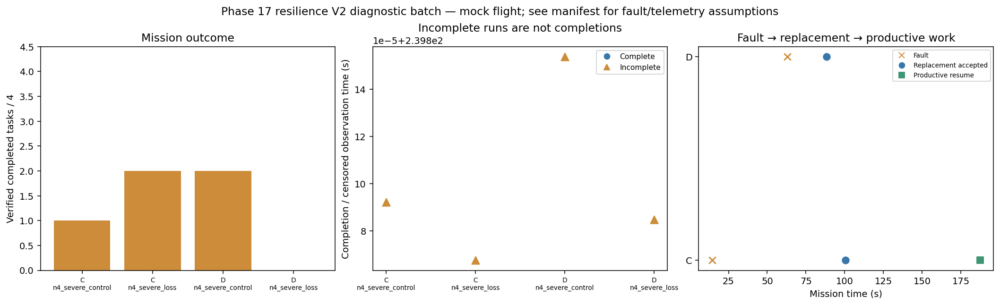

# Phase 17 resilience V2 diagnostic batch

Stage: severe; 4/4 runs; 0 completed missions.
Stored size: 10.12 MiB. Fault trigger: owned_motion. Telemetry: alive.

This is a new declared scenario, not final calibration. Replay is not LLM inference. Successful state-triggered recovery does not validate full radio-loss recovery.

| Case | Completed tasks | Complete | Time (s) | Replacement accepted at (s) | Productive resume at (s) |
|---|---:|---|---:|---:|---:|
| C_n4_severe_control_s7 | 1 | False | 239.80009215208702 | None | None |
| C_n4_severe_loss_s7 | 2 | False | 239.80006761301775 | 100.4004567390075 | 187.40009739401285 |
| D_n4_severe_control_s7 | 2 | False | 239.80015374103095 | None | None |
| D_n4_severe_loss_s7 | 0 | False | 239.80008472804911 | 88.20009925204795 | None |

