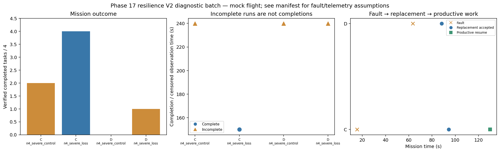

# Phase 17 resilience V2 diagnostic batch

Stage: severe; 4/4 runs; 1 completed missions.
Stored size: 9.18 MiB. Fault trigger: owned_motion. Telemetry: alive.

This is a new declared scenario, not final calibration. Replay is not LLM inference. Successful state-triggered recovery does not validate full radio-loss recovery.

| Case | Completed tasks | Complete | Time (s) | Replacement accepted at (s) | Productive resume at (s) |
|---|---:|---|---:|---:|---:|
| C_n4_severe_control_s8 | 2 | False | 239.80008221697062 | None | None |
| C_n4_severe_loss_s8 | 4 | True | 150.00009145401418 | 94.40097586996853 | 130.0000885759946 |
| D_n4_severe_control_s8 | 0 | False | 239.80009550100658 | None | None |
| D_n4_severe_loss_s8 | 1 | False | 239.80008758895565 | 88.2000870219199 | None |

