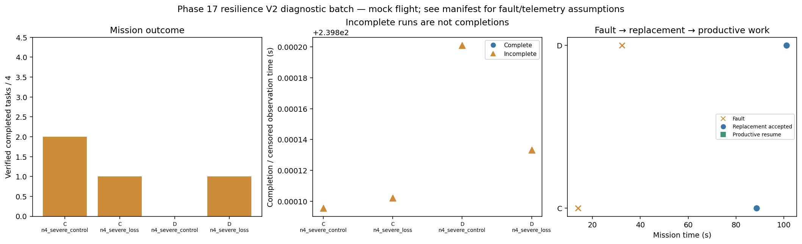

# Phase 17 resilience V2 diagnostic batch

Stage: severe; 4/4 runs; 0 completed missions.
Stored size: 9.30 MiB. Fault trigger: owned_motion. Telemetry: alive.

This is a new declared scenario, not final calibration. Replay is not LLM inference. Successful state-triggered recovery does not validate full radio-loss recovery.

| Case | Completed tasks | Complete | Time (s) | Replacement accepted at (s) | Productive resume at (s) |
|---|---:|---|---:|---:|---:|
| C_n4_severe_control_s9 | 2 | False | 239.80009550997056 | None | None |
| C_n4_severe_loss_s9 | 1 | False | 239.80010216706432 | 88.60265268501826 | None |
| D_n4_severe_control_s9 | 0 | False | 239.80020098690875 | None | None |
| D_n4_severe_loss_s9 | 1 | False | 239.8001331979176 | 101.0000795709202 | None |

