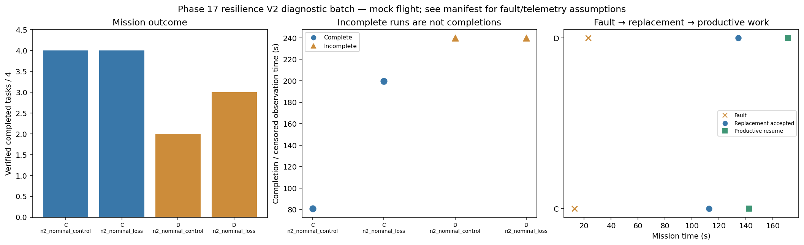

# Phase 17 resilience V2 diagnostic batch

Stage: focused; 4/4 runs; 2 completed missions.
Stored size: 2.87 MiB. Fault trigger: owned_motion. Telemetry: alive.

This is a new declared scenario, not final calibration. Replay is not LLM inference. Successful state-triggered recovery does not validate full radio-loss recovery.

| Case | Completed tasks | Complete | Time (s) | Replacement accepted at (s) | Productive resume at (s) |
|---|---:|---|---:|---:|---:|
| C_n2_nominal_control_s11 | 4 | True | 80.80024465700262 | None | None |
| C_n2_nominal_loss_s11 | 4 | True | 199.60023432099842 | 112.60022842300532 | 142.20023616499384 |
| D_n2_nominal_control_s11 | 2 | False | 239.8002278299973 | None | None |
| D_n2_nominal_loss_s11 | 3 | False | 239.80023550600163 | 134.20024635500158 | 171.20024263000232 |

