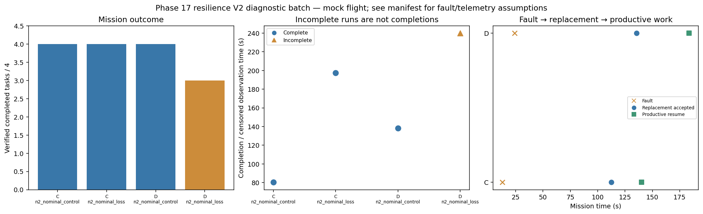

# Phase 17 resilience V2 diagnostic batch

Stage: focused; 4/4 runs; 3 completed missions.
Stored size: 2.70 MiB. Fault trigger: owned_motion. Telemetry: alive.

This is a new declared scenario, not final calibration. Replay is not LLM inference. Successful state-triggered recovery does not validate full radio-loss recovery.

| Case | Completed tasks | Complete | Time (s) | Replacement accepted at (s) | Productive resume at (s) |
|---|---:|---|---:|---:|---:|
| C_n2_nominal_control_s12 | 4 | True | 80.40022635299829 | None | None |
| C_n2_nominal_loss_s12 | 4 | True | 197.600242859 | 112.40023376799945 | 140.00023384200176 |
| D_n2_nominal_control_s12 | 4 | True | 138.40023723000195 | None | None |
| D_n2_nominal_loss_s12 | 3 | False | 239.8002293400059 | 135.60023627600458 | 183.6002328290051 |

