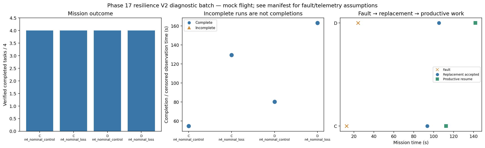

# Phase 17 resilience V2 diagnostic batch

Stage: focused; 4/4 runs; 4 completed missions.
Stored size: 5.02 MiB. Fault trigger: owned_motion. Telemetry: alive.

This is a new declared scenario, not final calibration. Replay is not LLM inference. Successful state-triggered recovery does not validate full radio-loss recovery.

| Case | Completed tasks | Complete | Time (s) | Replacement accepted at (s) | Productive resume at (s) |
|---|---:|---|---:|---:|---:|
| C_n4_nominal_control_s10 | 4 | True | 54.60023893600737 | None | None |
| C_n4_nominal_loss_s10 | 4 | True | 129.40015457999834 | 93.60023651299707 | 112.40014384199458 |
| D_n4_nominal_control_s10 | 4 | True | 80.20021752799221 | None | None |
| D_n4_nominal_loss_s10 | 4 | True | 163.00022407399956 | 105.2002429169952 | 141.80023136199452 |

