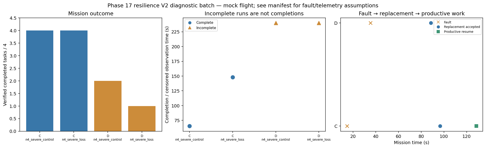

# Phase 17 resilience V2 diagnostic batch

Stage: severe; 4/4 runs; 2 completed missions.
Stored size: 7.92 MiB. Fault trigger: owned_motion. Telemetry: alive.

This is a new declared scenario, not final calibration. Replay is not LLM inference. Successful state-triggered recovery does not validate full radio-loss recovery.

| Case | Completed tasks | Complete | Time (s) | Replacement accepted at (s) | Productive resume at (s) |
|---|---:|---|---:|---:|---:|
| C_n4_severe_control_s10 | 4 | True | 65.40022685800795 | None | None |
| C_n4_severe_loss_s10 | 4 | True | 148.00024319099612 | 96.6002255469939 | 128.600219740998 |
| D_n4_severe_control_s10 | 2 | False | 239.8000868010131 | None | None |
| D_n4_severe_loss_s10 | 1 | False | 239.80008213700785 | 88.60008987999754 | None |

