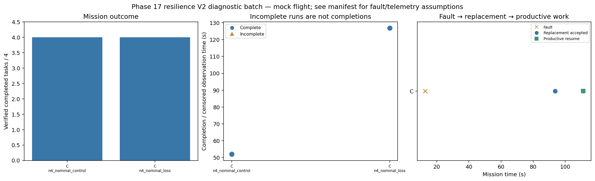

# Phase 17 resilience V2 diagnostic batch

Stage: smoke; 2/2 runs; 2 completed missions.
Stored size: 2.16 MiB. Fault trigger: owned_motion. Telemetry: alive.

This is a new declared scenario, not final calibration. Replay is not LLM inference. Successful state-triggered recovery does not validate full radio-loss recovery.

| Case | Completed tasks | Complete | Time (s) | Replacement accepted at (s) | Productive resume at (s) |
|---|---:|---|---:|---:|---:|
| C_n4_nominal_control_s10 | 4 | True | 52.0 | None | None |
| C_n4_nominal_loss_s10 | 4 | True | 126.8 | 93.6 | 111.2 |

